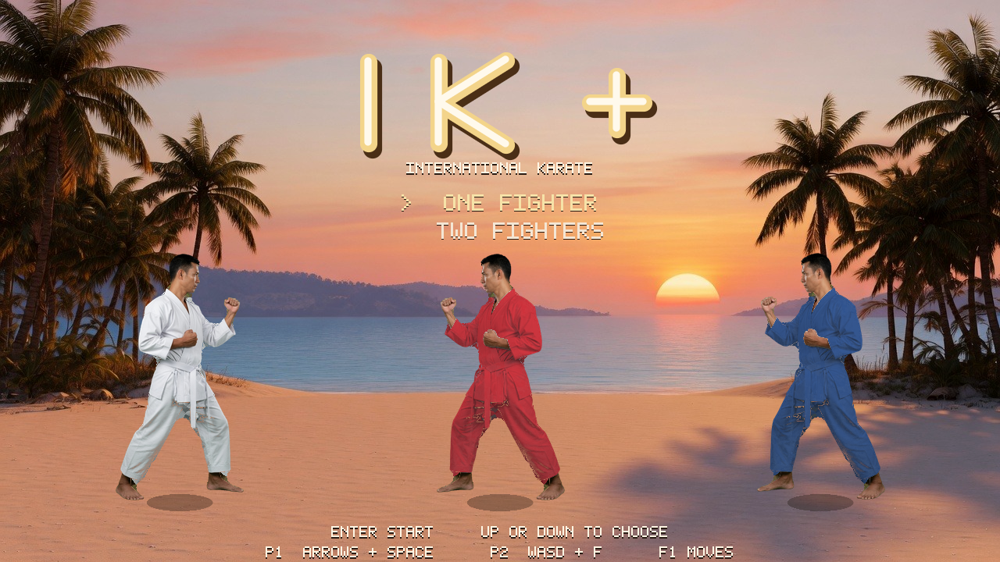
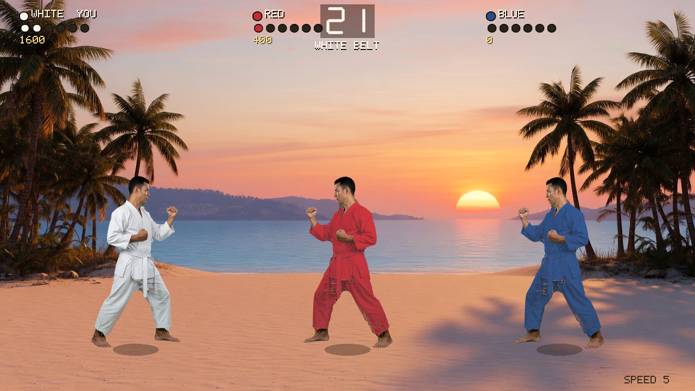
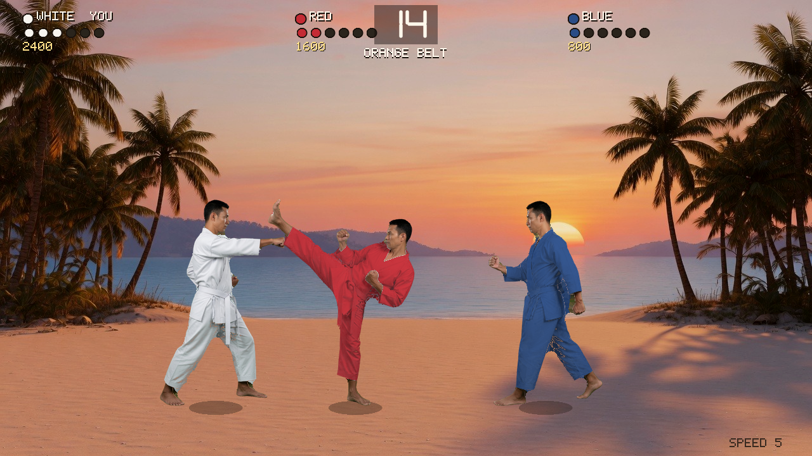
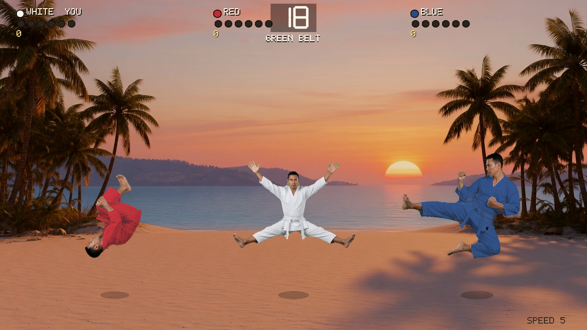
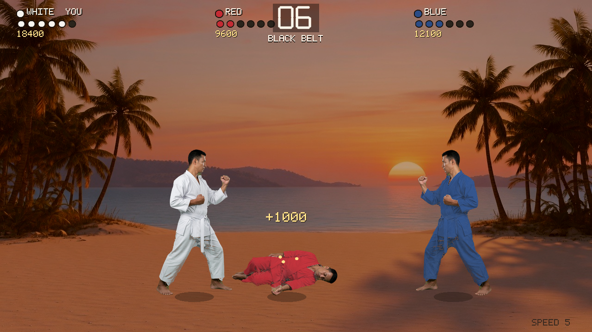
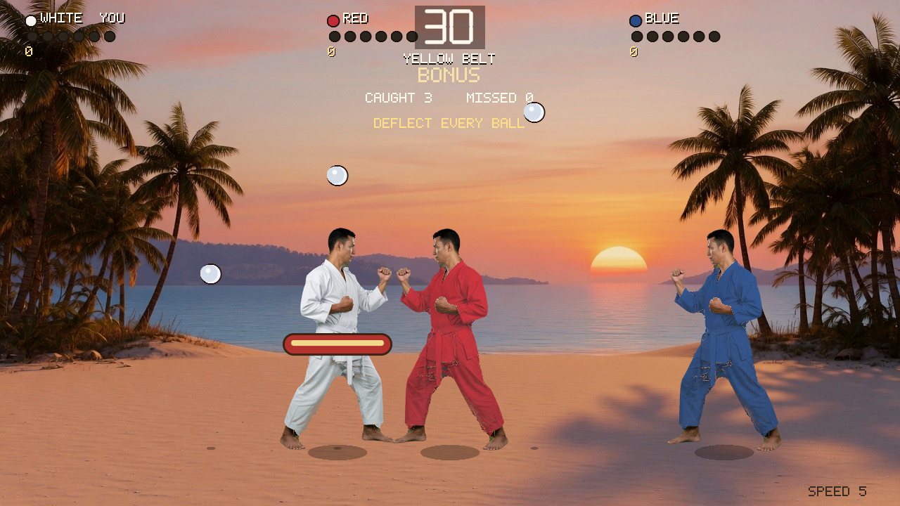
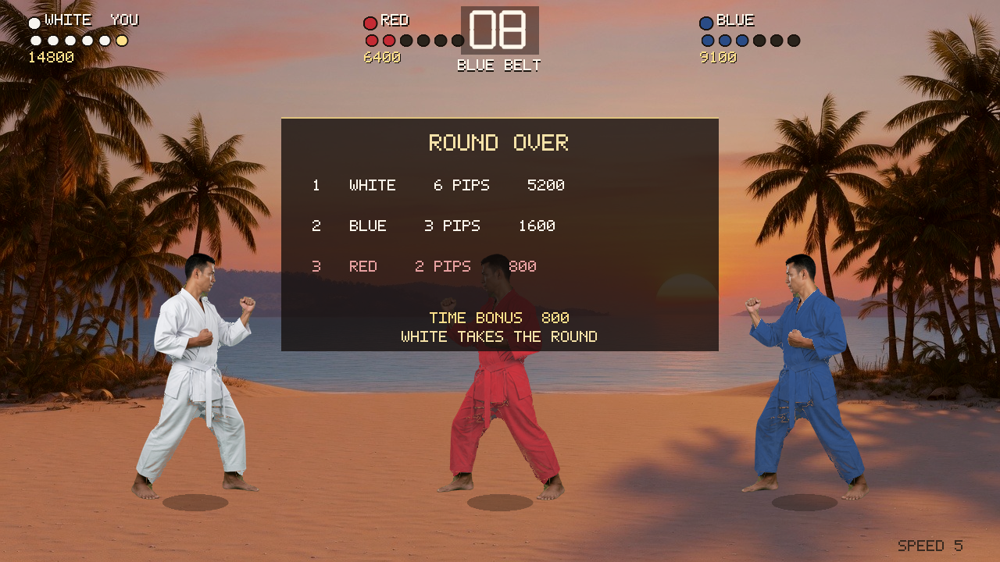

# IK+

An unofficial modern tribute to System 3's *International Karate +* (1987). Three fighters share one sunset beach. Any of them can hit either of the others, including the two computer fighters. The pictures and the music in this build are original. It is not affiliated with System 3 or Archer Maclean.

You play the white fighter. Red and blue are the other two. In a two-player game the second human plays red. A round lasts 30 seconds, or until someone reaches six pips. First and second go through. Last place is out. A computer in last place is replaced by a fresh challenger. If the only human is in last place, the match is over. In two-player, the lower human is replaced by a computer and the other human keeps going. Survivors keep their total score. Pips reset each round.

Belts run white, yellow, orange, green, blue, purple, brown, black, then black dan. Every even round opens a bonus: balls bounce in, and the surviving human moves a shield. A deflect is 250 points. Clearing every ball adds a 5000 survival bonus.

Facing is sticky. Directions are relative to the way you face. Walking backward blocks and does not turn you around. A reverse punch, a reverse sweep, or a back-step kick is what turns you. A hit from the front is two pips and the full score. A hit in the back is one pip and half the score. The double kick scores on both sides. Blocking stops a high or mid attack from the front. Sweeps are not blocked. A low attack misses someone who is in the air.

The beach and the fighter poses are photographs compiled into the program. You do not copy image or audio files next to the executable.

## Screenshots

Title. Choose one or two fighters.



A round underway. White has two pips, red has one, the clock is at 21.



White punches, red throws a high kick, blue blocks.



Backflip, the jumping split kick, and a flying kick.



Later rounds darken toward dusk. Red is down.



The bonus stage. Move the shield and keep the balls off the sand.



The round card. Rank is pips, then round score.



Regenerate these without opening a window:

```
cargo run -- --shots
```

## Build

Install the current stable Rust toolchain from [rustup.rs](https://rustup.rs). The game is one Rust crate. Release builds are the ones to play. The first release compile takes a minute. Later ones are quick.

### Mac

Install the Xcode command line tools if you do not already have them:

```
xcode-select --install
```

Then, in this folder:

```
cargo run --release
```

The program is `target/release/ik-plus`. You can start that file directly the next time.

### Windows

Use the default `x86_64-pc-windows-msvc` toolchain that rustup installs. If the prompt says the MSVC linker is missing, install [Visual Studio Build Tools](https://visualstudio.microsoft.com/visual-cpp-build-tools/) and select the **Desktop development with C++** workload. That provides the MSVC compiler and the Windows SDK. Then, in this folder, from Command Prompt or PowerShell:

```
cargo run --release
```

The program is `target\release\ik-plus.exe`. You can start that file directly the next time. The photographs are inside the executable, so the `.exe` does not need an `assets` folder beside it.

## Start

Launch with `cargo run --release`, or run the executable from the paths above. Click the window once so the keys reach the game.

On the title screen:

- Press `1` for one fighter, or `2` for two.
- Or press Up and Down to move the cursor, then Enter to start the highlighted choice. Player 2 can use W and S for that menu.

Enter skips the result card and starts a rematch after you are eliminated. The bow at the start of a round plays itself out. Esc quits.

## Controls

| Key | Action |
| --- | --- |
| Left / Right, or A / D | Walk forward, or step back and block |
| Up / Down, or W / S | Jump, sweep, and the diagonal strikes |
| Space, or Z | Attack button for player 1. Hold it and press a direction. |
| F | Attack button for player 2 |
| Enter | Start, skip the result card, rematch |
| 1 / 2 | Start a one-player or two-player match from the title |
| F1 | Move list |
| P | Pause |
| M | Mute |
| - / = | Slower or faster. Speed 1 through 8. The default is 5. |
| Esc | Quit |

Without the attack button: Up jumps, Up-Forward is a front punch, Forward walks, Down-Forward is a shin kick, Down sweeps, Down-Back is a stomach punch, Back blocks, Up-Back is a reverse punch.

With the attack button held: Up is a flying kick, Up-Forward is a headbutt, Forward is a stomach kick, Down-Forward is a face kick, Down is a reverse sweep, Down-Back is a back kick, Back is a backflip, Up-Back is the double kick.

Scores: punch 800, shin kick, sweep, stomach punch, and reverse sweep 400, stomach kick 200, flying kick, face kick, and back kick 800, headbutt and double kick 1000. Reaching six pips also pays 100 points for each second left on the clock.

## Sound

The music and the hits are synthesized when the game starts. There are no audio files. If the machine has no audio device, the game says so and keeps running. M mutes the sound.
